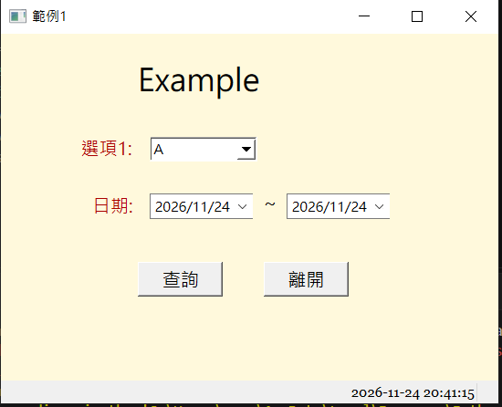

# 點數折抵統計程式

一個以 **Python、PyQt6 與 SQLAlchemy** 製作的桌面應用程式，用於查詢指定日期區間與分類的交易資料，並將統計結果匯出為 Excel 檔案。

## 功能

- 使用 PyQt6 建立圖形化操作介面
- 選擇欄位分類（A、B、C）
- 選擇起註與結束日期
- 限制只能查詢同一月份的資料
- 依日期分組統計正向與反向金額
- 自動將結果匯出到使用者的 `Downloads` 資料夾
- 顯示目前系統時間

## 畫面預覽



## 專案檔案

| 檔案 | 說明 |
| --- | --- |
| `main.py` | 程式進入點 |
| `ui_Controller.py` | 視窗事件、按鈕與查詢流程控制 |
| `qt_ui.py` | 由 Qt Designer `.ui` 檔產生的介面程式 |
| `Point_use.ui` | Qt Designer 原始介面檔案 |
| `DB_conn.py` | SQL Server連線、查詢及 Excel 匯出邏輯 |
| `qt_point.py` | 介面範例程式 |
| `說明.txt` | `.ui` 轉換及 PyInstaller 打包備註 |
| `執行畫面.PNG` | 程式畫面預覽 |

## 環境需求

- Windows
- Python 3.10 或以上版本
- 可連線的 Microsoft SQL Server / MSSQL 資料庫

## 安裝

建議使用虛擬環境：

```powershell
python -m venv .venv
.venv\Scripts\Activate.ps1
pip install PyQt6 sqlalchemy pymssql pandas openpyxl pyyaml
```

## 資料庫設定

在專案根目錄建立 `db_info.yaml`，並填入實際資料庫資訊：

```yaml
DB_addr: "伺服器位址或 IP"
DB_name: "資料庫名稱"
DB_User: "資料庫帳號"
DB_paswd: "資料庫密碼"
```

> `db_info.yaml` 未包含在專案中。請勿將包含真實帳號或密碼的設定檔提交至公開的程式碼儲存庫。

程式透過以下 SQLAlchemy 驅動連線：

```text
mssql+pymssql://<帳號>:<密碼>@<伺服器>/<資料庫>
```

## 執行方式

```powershell
python main.py
```

執行後：

1. 在下拉選單選擇 A、B 或 C。
2. 選擇起註與結束日期。
3. 點選「查詢」。
4. 程式將查詢資料並產生 Excel 檔案。
5. 匯出的檔案會儲存在目前 Windows 使用者的 `Downloads` 資料夾。

檔名格式：

```text
<起始日>-<結束日後四碼>_<分類>計算_<時分秒>.xlsx
```

## 查詢限制

- 起註與結束日期必須位於同一月份。
- 程式會將分類值轉換為對應名稱：
  - A -> Ace
  - B -> Two
  - C -> Three
- 查詢與匯出失敗時，介面會顯示錯誤訊息。

## 打包成 Windows 執行檔

專案可使用 PyInstaller 打包：

```powershell
pyi-makespec main.py
```

產生 `main.spec` 後，於 `hiddenimports` 加入必要模組：

```python
hiddenimports=[
    'pymssql',
    'sqlalchemy',
    'sqlalchemy.sql.default_comparator',
]
```

最後執行：

```powershell
pyinstaller main.spec
```
